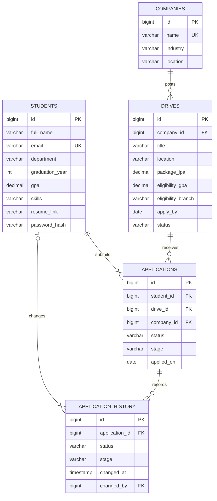

# Database relationship diagram

`APPLICATIONS` connects a student to a placement drive. Each drive belongs to a company. `APPLICATION_HISTORY` stores each status/stage change so students can see the timeline.
